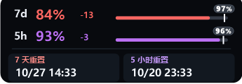
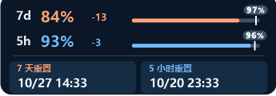
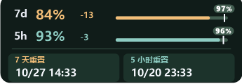
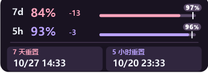
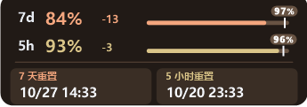
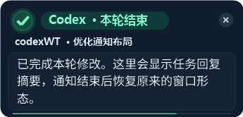

# QuotaDock

**Windows 原生 Codex 额度悬浮组件。** 在屏幕边缘查看 7 天 / 5 小时剩余额度，用灵动岛通知和状态丝带掌握任务进度。

Rust · Win32 · GDI+ · Windows 10/11 · MIT



**下载 Windows x64 版本：[v0.4.0 发布页](https://github.com/yanhuigang173/QuotaDock/releases/tag/v0.4.0)** · [详细使用说明](docs/USAGE.md)

## 功能

- **额度一目了然**：同时显示两组剩余额度、理想进度刻度、偏差与重置时间。
- **融合吸附**：上下边缘显示横条，左右边缘显示竖条，拖离边缘恢复紧凑 HUD。
- **平滑展开**：悬停查看详情，双击切换完整窗口；通知结束恢复原布局。
- **任务提醒**：默认监听本地会话完成记录，展示项目、任务名与回复摘要，Hook 为可选通道。
- **状态灯与丝带**：灰色无任务、蓝色运行中、绿色完成、橙色中断；独立开关，支持四档丝带强度。
- **五套主题**：经典默认、深海蓝、松林绿、暮光紫、暖砂棕。
- **可保存设置**：摘要字数和行数上限、置顶、缩放、底板样式、通知来源与刷新间隔。
- **原生窗口**：当前构建不需要 Electron、Tauri 或 WebView2 Runtime。

## 窗口形态与操作

### 横向细条：放在屏幕上沿或下沿


横向细条直接显示 `7d`、`5h` 剩余百分比和对应进度条，适合长时间挂在屏幕边缘。默认主题中，红色对应 **7 天额度**，紫色对应 **5 小时额度**，深灰色轨道代表未填充部分；切换主题后两组额度会采用对应的主题配色。

上图外沿的蓝色色带表示有任务正在运行，右端的小蓝环是点状状态灯的运行样式。这些任务状态提示与额度百分比独立：**额度颜色不等于任务状态颜色**。静态截图只能展示某一帧，实际运行时色带会沿可见边缘流动，蓝环会旋转。

### 竖向细条：贴在屏幕左侧或右侧


融合模式靠近左右边缘时，组件变为窄竖条，减少对网页和编辑器横向空间的占用：

- **左轨为 7 天额度，右轨为 5 小时额度**；顶部两个小色点帮助区分两条轨道。
- 彩色段从底部向上填充，长度表示当前剩余额度比例，灰色段为未填充轨道。
- 细白横线是按额度周期与重置时间计算的**理想剩余刻度**，用于和实际余量比较，不是近期消耗速度预测。
- 底部的小点 / 短横线是任务状态灯。上图灰点表示当前没有已跟踪的任务；关闭状态灯后不会显示该标记。
- 悬停时向屏幕内侧展开为横向详情面板，显示数字、理想刻度和重置时间；移开后收起为竖条。

这两张图是运行时截图，仅展示当时的数据；下方主题和通知图为示例数据预览。

### 五种使用形态

| 形态 | 适用位置与显示内容 | 如何进入 |
| --- | --- | --- |
| 横向细条 | 屏幕上下边缘；两组百分比与进度条 | 选择“顶部细条”，或在融合模式拖到上下边缘 |
| 竖向细条 | 屏幕左右边缘；双轨额度与理想刻度 | 在融合模式拖到左右边缘 |
| 紧凑 HUD | 屏幕中间；圆角小面板 | 选择“紧凑 HUD”，或将融合模式组件拖离边缘 |
| 悬停详情 | 数字、理想刻度、偏差和两组重置时间 | 鼠标悬停在细条 / HUD 上，移开后自动收起 |
| 完整窗口 | 更完整的额度、套餐与状态信息 | 双击细条 / HUD，再双击恢复原来的形态和位置 |

吸附发生在拖动松手后。上下吸附保留横条，左右吸附变为竖条；底部同时支持任务栏上沿与屏幕最底边。贴边一侧不画丝带，其余可见边缘保留效果，不额外增加与屏幕边缘的间隔。

## 任务状态、状态灯与丝带

| 状态 | 颜色 | 状态灯表现 | 边缘丝带表现 |
| --- | --- | --- | --- |
| 无任务 | 灰色 | 常亮的小点 / 小条 | 隐藏 |
| 进行中 | 蓝色 | 条形缓慢呼吸，点状旋转 | 沿可见边缘流动 |
| 本轮完成 | 黄绿色 | 常亮，保留约 3 分钟 | 同色静态色带，保留约 3 分钟 |
| 已中断 | 橙色 | 常亮，保留约 1 分钟 | 同色静态色带，保留约 1 分钟 |

在 **任务状态与丝带** 中，状态灯和丝带可以单独启用，也可以同时启用。丝带强度有 **柔和 / 标准 / 醒目 / 高亮** 四档；状态灯有条形和点状两种样式。选择立即生效并保存。悬停展开或显示通知时，紧凑状态提示会隐藏，收起后恢复。

多项目并行时，只要仍有已跟踪的任务运行，就显示蓝色；全部结束后显示最近一次完成或中断结果。“进行中”可能包含等待输入或授权；“本轮完成”也可能是 Codex 提问后等待回复，不能据此认定整个需求已完成。未写出明确中止事件的崩溃或断网，暂不能可靠显示为中断。

### 如何读懂展开面板

- `7d` / `5h`：7 天和 5 小时额度周期。
- 大号百分比和彩色进度条：实际剩余额度。
- 白色百分比标记及短刻度：该周期理想剩余额度。
- `+` / `−` 偏差：实际余量减去理想余量，单位为百分点；正数表示比理想进度多剩，负数表示比理想进度少剩。
- 底部日期与时间：相应周期的下次重置时间，按本机时间显示。

这些信息描述额度余量与周期进度，不是实时计费金额，也不保证接下来还可发送多少条消息。

## 配色预览

| 深海蓝 | 松林绿 |
| --- | --- |
|  |  |

| 暮光紫 | 暖砂棕 |
| --- | --- |
|  |  |

### 任务通知



主题和任务通知预览由程序使用示例数据绘制，不代表实时额度。

## 开始使用

1. 在 Windows 10/11 上安装、登录 Codex CLI，确保本机可以运行 `codex`。额度读取依赖本机 CLI；任务通知默认直接读取桌面会话记录。
2. 从 [v0.4.0 发布页](https://github.com/yanhuigang173/QuotaDock/releases/tag/v0.4.0) 下载 `QuotaDock.exe` 或便携 ZIP；也可自行构建。
3. 双击 EXE。左键托盘图标显示 / 隐藏窗口，右键打开设置。

常用操作：拖动移动、悬停展开、双击切换完整窗口、滚轮调整缩放。关闭窗口会隐藏到托盘，彻底退出请使用菜单中的“退出 QuotaDock”。

### 托盘菜单

| 菜单 | 内容 |
| --- | --- |
| 窗口布局 | 紧凑 HUD、顶部细条、融合模式、完整窗口、始终置顶 |
| 外观与托盘 | 颜色主题、紧凑 HUD 深色底板、托盘图标精度 |
| 任务状态与丝带 | 状态灯、条形 / 点状、边缘丝带、丝带强度 |
| 通知设置 | 任务结束通知、摘要与行数上限、额度重置提醒、预览 |
| Codex 集成 | 权限确认、任务接收方式、可选 Hook 设置 |
| 常规设置 | 开机启动、额度刷新间隔 |

## 从源码构建

需要 Windows、Rust GNU 工具链，以及 PATH 中的 MinGW `gcc` 和 `windres`。

```powershell
rustup toolchain install stable-x86_64-pc-windows-gnu
rustup override set stable-x86_64-pc-windows-gnu
powershell -NoProfile -ExecutionPolicy Bypass -File scripts/build.ps1
```

首次构建需要联网下载 Rust 依赖。依赖已缓存时，可在构建命令末尾加 `-Offline`。输出为 `dist/QuotaDock.exe`，不需要运行 `npm install`。

构建脚本会关闭当前工作目录 `dist/QuotaDock.exe` 的运行实例以替换文件；构建结束后需要重新启动。

完整环境配置见 [构建说明](docs/BUILD.md)。

## 数据与兼容性

- 设置、额度缓存和通知去重记录保存在 `%APPDATA%\cn.codex.quota.widget\`。
- 额度来自本机 Codex CLI 的 `account/rateLimits/read`；可用 `CODEX_CLI_PATH` 指定 CLI 路径。
- 本地任务记录默认读取 `~/.codex/sessions`，支持 `CODEX_HOME` 指定位置。QuotaDock 不主动上传会话和通知摘要。
- 任务通知不要求安装 Hook；可选 Hook 首次使用仍需由用户在 Codex 中审阅并信任。
- 本轮结束也可能是等待用户回复，不代表整个需求完成；未写出中断事件的崩溃、断网不能可靠识别。
- 云端任务没有本地记录时无法通过本地监听显示通知。Codex 更改协议或记录格式后可能需要适配。

更多功能及 Hook 操作见 [使用说明](docs/USAGE.md)。

## 项目结构

```text
src-native/       当前 Rust / Win32 实现与 Cargo.lock
src/             历史 JavaScript 界面和节奏分析实现
src-tauri/       历史 Tauri 实现（当前构建不使用）
scripts/         构建、源码整理、回归验证脚本
assets/          程序图标与历史界面资源
docs/            使用、构建、发布说明和界面预览
```

编译缓存、个人 Codex 配置、测试记录、诊断产物和 EXE 均不纳入源码仓库。EXE 适合作为 GitHub Release 附件发布。

## 参与与许可

提交问题请附上系统版本、缩放比例、窗口模式和复现步骤；不要附带登录凭据或完整会话。开发说明见 [CONTRIBUTING.md](CONTRIBUTING.md)。

本项目以 [MIT License](LICENSE) 分发，基于既有 Codex 额度组件演进，上游署名及依赖说明见 [THIRD_PARTY_NOTICES.md](THIRD_PARTY_NOTICES.md)。QuotaDock 与 OpenAI 没有官方关联。
