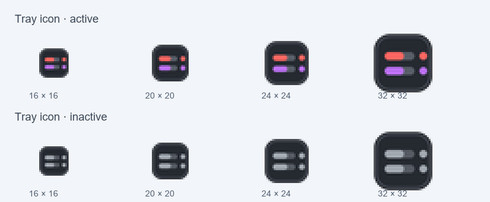

# QuotaDock

QuotaDock 是一个 Windows 上的 Codex 额度小组件。当前版本使用 Rust 和 Windows 原生窗口、GDI+ 绘制以及系统通知区域 API，不使用 Tauri、WebView2 或单独的应用 DLL。

## 当前功能

- HUD 同时显示 7 天与 5 小时的实际剩余额度、白色理想剩余额度刻度和偏差。
- 完整窗口使用左侧额度圆球和右侧 5 小时、7 天、套餐卡片；标题栏可直接置顶、刷新或隐藏。
- “窗口布局 → 融合模式”会在拖动松手后自动判断位置：靠近上下边缘变横向细条，靠近左右边缘变竖向细条，拖离边缘恢复圆角紧凑 HUD。靠边形态悬停时向屏幕内展开，显示两行额度、进度条与重置时间。
- 双击紧凑 HUD 或细条进入完整窗口，再双击恢复之前的形态和位置；融合模式选择会保存。
- 滚轮可缩放 HUD；右键窗口或托盘图标可切换显示、紧凑模式、顶部细条、置顶和主题。
- “外观与托盘 → 颜色主题”提供经典（默认）、深海蓝、松林绿、暮光紫、暖砂棕五套配色，统一调整窗口底板、额度和通知卡片，立即生效并自动保存；任务状态灯与丝带的状态颜色保持一致。
- “窗口布局 → 始终置顶”和“外观与托盘 → 紧凑 HUD · 深色底板”会保存并在重启后恢复；旧设置默认置顶，使用原有 HUD 底板。
- 后台读取本机 Codex CLI 的额度，定时刷新并缓存上次成功的数据；读取失败时保留旧数据并标记为旧数据。
- 托盘图标的两条进度分别代表 5 小时和 7 天剩余额度。图标默认按 **3% 档位** 绘制，可在托盘菜单切换为 1%、3% 或 5%；悬停提示始终显示实际整数百分比，与窗口数字一致。
- 可在托盘菜单设置额度刷新间隔为 1、3、5、10 或 30 分钟。
- 托盘菜单“通知设置 → 额度重置通知”可总开关提醒，并分别设置一级 7 天额度的到时间重置、提前恢复提醒，以及二级 5 小时额度的到时间重置。7 天提醒先显示，5 小时提醒随后显示。
- 可在托盘菜单的“常规设置”子菜单切换当前用户的开机自启动。
- Codex Hook 可在任务结束时显示回复摘要；对 `PermissionRequest` 可启用 QuotaDock 的允许/拒绝确认框。确认框默认选中拒绝，选择仅对当前操作生效；关闭后由 Codex 显示原生授权提示。
- Codex 本轮结束可通过 `Stop` Hook 触发灵动岛通知，显示项目目录名和最后回复的摘要；任务通知独立开关，不受额度重置提醒开关或弹窗样式影响。



## 运行

下载或构建 `QuotaDock.exe`，双击运行。需要 Windows 10/11，以及已安装并登录、可从本机运行的 Codex CLI。此版本不需要 `WebView2Loader.dll`，也不需要 WebView2 Runtime。

托盘图标左键显示或隐藏窗口，右键打开菜单。右键 HUD 也能打开同一菜单。关闭窗口会隐藏到托盘，使用菜单里的“退出”可结束程序。

“开机自启动”使用当前用户的 Windows 启动项，指向当前 `QuotaDock.exe` 的完整路径。移动 EXE 后，重新勾选此选项即可更新路径。

在“通知设置 → 额度重置通知 → 通知样式”选择“弹窗”或“灵动岛”，默认使用灵动岛。灵动岛通知会从当前窗口位置展开约 10 秒，显示消息与当前额度，随后自动收起并恢复原来的视图；也可点右上角关闭。“弹窗”使用需要确认关闭的原生 Windows 对话框。

顶条悬停和灵动岛通知保持原宽度，使用高度缓动与内容淡出、淡入；连续通知直接过渡内容。滚轮调整的整体尺寸会保存。

融合模式的左右竖条悬停或收到灵动岛通知时，平滑展开为横向信息面板，结束后恢复竖条。吸附使用当前显示器的可用区域，并设置脱离缓冲距离，避免边缘附近反复切换。底部任务栏支持两个吸附位置：任务栏上沿（工作区底边）和任务栏区域内的屏幕最底边，拖近对应边界后松手即可切换，吸附侧会保存。最底边的细条自动置顶以保持可见，拖离后恢复用户的置顶设置；悬停和通知从所选边界向上展开。

原生动画用同一层外壳连续改变高度和圆角，内部内容单独淡入淡出；按桌面合成器刷新节奏提交画面并复用绘图缓冲区。默认缩放保留原来的 0.46。

“通知设置 → 额度重置通知 → 预览两级通知”可检查当前样式和显示顺序。7 天额度在预定时间前明显增加时会提示“可能是官方奖励或额度调整”；额度接口没有提供该变化的明确原因。

## Codex 本轮结束通知

托盘菜单“Codex 集成 → 任务接收方式”可选择“本地记录（默认）”“仅 Hook”或“本地记录 + Hook（自动去重）”。首次使用和未保存此选项的旧设置均默认本地记录；选择立即生效并保存，重启后保留。仅 Hook 模式停止从本地记录产生完成通知；若状态灯和丝带均关闭，则停止读取本地会话内容。重新开启本地记录时，不补发停用期间的旧完成记录。此设置只影响任务结束通知，不改变权限确认功能。

保持 QuotaDock 运行，在托盘菜单“通知设置”开启任务结束通知即可。桌面兼容通道通过 Windows 文件变更通知接收本机 `~/.codex/sessions` 中新增的 `task_complete` 记录，显示项目名和最后回复摘要，不依赖桌面内核实际派发 `Stop` Hook。旧会话记录不会在启动时补发，也不会把开始执行、部分写入或工具输出当成完成。

通知持续约 10 秒，之后恢复原窗口；“预览任务结束通知”可以查看显示效果。兼容通道按当前本地桌面会话格式读取，Codex 若改变记录格式，可能需要适配。云端任务没有本地完成记录时不在这一通道的支持范围内。

### 任务状态灯

“任务状态与丝带”子菜单提供独立的“显示状态灯”和“显示边缘丝带”开关，可同时开启或单独使用。状态灯可选条形或点状，默认开启并使用条形；丝带默认关闭，所有选择自动保存。旧版边缘流动样式会自动迁移为独立丝带开关。灰色表示无任务，蓝色表示进行中，绿色表示完成，橙色表示中断，状态灯与丝带共用任务状态和颜色。它们独立读取本地 `task_started`、`task_complete`、`turn_aborted` 事件，不依赖完成通知开关或 Hook。融合模式贴靠左右屏幕边缘时，条形灯会转为底部短横线，点状仍显示圆点或旋转圆环。

多项目任务并行时，只要还有任务进行中就显示蓝色。所有任务结束后显示最近一次完成或中断状态：完成绿灯保留 3 分钟，中断橙灯保留 1 分钟，然后恢复灰色。启动前开始的任务，在对应会话继续写入记录、且末尾能找到开始事件时恢复跟踪，不补发历史完成通知。“进行中”也可能包含等待用户回复或授权；中断以明确的中止事件为准，未写出中止记录的崩溃或断网暂不能可靠判断。

条形样式进行中的蓝灯以约 2.8 秒为一轮缓慢呼吸，最低保留约 45% 亮度；点状样式进行中显示蓝色旋转圆环，约 1.8 秒一圈，其他状态显示常亮实心圆点。展开面板时隐藏状态灯，隐藏窗口、拖动或关闭状态灯时暂停动画，收起后恢复。

边缘丝带以蓝色渐淡光带沿顶条或紧凑 HUD 的外沿循环，约 4.4 秒一圈；完成时显示整圈绿色细带，中断时显示整圈橙色细带，无任务时完全隐藏边缘效果。横向、竖向和圆角 HUD 均沿当前外形绘制，不改变窗口尺寸。关闭状态灯不会关闭丝带，关闭丝带也不会影响状态灯。

融合模式吸附边缘时，贴边一侧不绘制丝带，也不为丝带预留间隔；顶部吸附时顶条贴齐屏幕上沿，流动效果沿其余可见边缘运行。底部和左右吸附采用相同处理。

“任务状态与丝带 → 丝带强度”提供柔和、标准、醒目、高亮四档，联动调整线宽、亮度和流动拖尾长度，默认标准。高亮档采用更厚的色带与更长的明亮拖尾。选择立即生效并自动保存，不改变窗口尺寸或贴边位置。

“摘要上限”和“行数上限”分别提供 40/80/140/280/500 字、1/2/3/4/6 行设置，默认 140 字、2 行，两项上限同时生效。通知按当前字体、缩放和宽度测量实际换行数，短消息自动缩小高度，不填满所选行数；超出上限的内容省略，设置自动保存。

### 可选的 Hook 通道

对于正常派发 `Stop` 的 Codex 运行环境，可以额外连接 Hook：

1. 在“Codex 集成 → Hook 设置”选择“安装 Hook 并打开审阅”，自动添加通知配置并打开独立 Codex 审阅终端。也可运行 `QuotaDock.exe --install-codex-hook`，后面可以指定配置目录。
2. 关闭提示框，在终端输入 `/hooks`，向下找到 `Stop` 并按 Enter，审阅并信任“QuotaDock 任务通知”。首次信任必须由用户完成；设置不会代为批准。
3. 重新打开 Codex 会话。更改 EXE 位置后，需更新 Hook 路径；只开关通知不必重新连接。

配置只添加 / 更新用户级 `hooks.json` 中的 QuotaDock 命令，保留其他 Hook，修改已有文件前生成 `.bak`，不改变 `config.toml` 中原有的 `notify`。Hook 与桌面兼容通道共用会话、轮次去重，同一轮不会重复显示。

Hook 使用同一个 EXE 的无窗口入口 `--codex-stop`，不需要额外 Python、Node 或 DLL。收到一个完整 JSON 对象后即处理，不等待管道关闭；经本地原子文件队列交给窗口。仅保存最多约 500 个字符的摘要，显示时再应用所选字数、行数上限，不复制完整会话、不上传数据；关闭通知期间的事件不会在重新开启时补发。

`%APPDATA%\cn.codex.quota.widget\codex-hook-last.json` 记录最近一次输入的接收阶段及来源，便于区分 Hook 未调用和窗口未接收，不记录完整回复。

这里的“本轮结束”也包括 Codex 提问后等待回复，不表示整个需求必然完成。官方 Hook 接口和适用范围见 [Hooks 文档](https://learn.chatgpt.com/docs/hooks)。

## 从源码构建

在 Windows 上安装 Rust 的 GNU 工具链和 MinGW `windres`，然后运行：

```powershell
powershell -NoProfile -ExecutionPolicy Bypass -File scripts/build.ps1
```

产物为 [`dist/QuotaDock.exe`](../dist/QuotaDock.exe)，可单独复制运行。原生源码位于 `src-native/`；`src-tauri/` 和 `src/` 保留了此前 WebView2 版的源码及旧版节奏分析实现，当前构建不使用它们。

## 数据说明

实际剩余百分比来自 Codex `account/rateLimits/read`。白色理想剩余刻度按窗口重置时间与时长计算。界面不再显示青色速度估算刻度。

设置与额度缓存位于 `%APPDATA%\cn.codex.quota.widget\`。可通过环境变量 `CODEX_CLI_PATH` 指向特定的 `codex.exe`。

## 来源

本项目改造自 [xicunwus2025-sys/codex-led-widget](https://github.com/xicunwus2025-sys/codex-led-widget)。项目许可：MIT。
